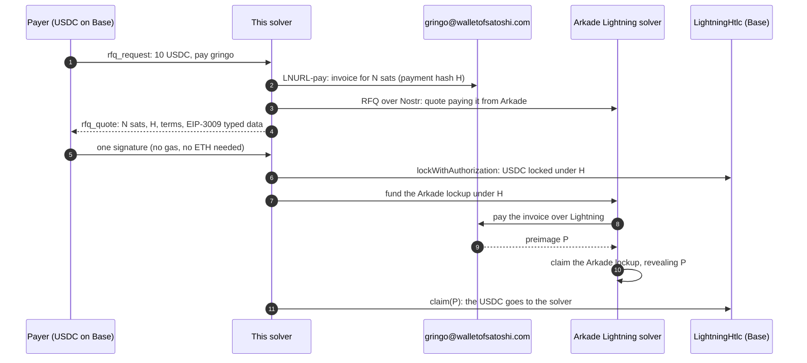

# USDC on Base → BTC within Arkade → `gringo@walletofsatoshi.com`

A solver that accepts USDC on Base and pays the equivalent in sats to a Lightning address
(`gringo@walletofsatoshi.com` by default), out of its own BTC inventory within
[Arkade](https://docs.arkadeos.com).

It is built the way [Arkade Intents](https://docs.arkadeos.com/intents/index.md) builds its
corridor routes: **intent → quote → fund → fill**, settled by **paired HTLCs that share one payment
hash**. Here the hash is the Lightning invoice's, and it locks three contracts at once:

| Leg | Network | Contract | Who claims it, with what |
| - | - | - | - |
| Payer's USDC | Base | `LightningHtlc` (this repo) | the solver, with the invoice preimage |
| Solver's BTC | Arkade | VHTLC lockup ([Arkade Intents](https://docs.arkadeos.com/intents/reference/corridor-swaps.md)) | the Arkade Lightning solver, with the preimage it learns by paying |
| Payout | Lightning | the invoice's HTLCs | Wallet of Satoshi, which releases the preimage |

The USDC can only move to the solver once the preimage exists, and the preimage only exists once
the Lightning address has been paid. The preimage is the payer's proof of payment.



## What was verified

Everything below ran in this repository's environment on 2026-11-13. No real funds moved: the
solver's Arkade wallet was empty, so the final funding step (`client.accept` of the Arkade
Lightning quote) is the one step that has not been exercised live.

| Check | How | Result |
| - | - | - |
| Lightning address | `pnpm check:live`: resolve `gringo@walletofsatoshi.com` (LUD-16), fetch an invoice (LUD-06), check amount, network, expiry, and that its description hash commits to gringo's LNURL metadata | passes against Wallet of Satoshi |
| Arkade → Lightning route | `pnpm check:live`: a throwaway mainnet wallet asks the Arkade Lightning solver (`beta-solver`, over Nostr) to quote paying that invoice; the swap client verifies the quote and derives the lockup locally | e.g. 1,000 sats costs 1,006 sats locked; refund window ~14.6 days |
| Price | median of Coinbase, Kraken, CoinGecko, refused if they disagree | passes |
| HTLC contract | `test/htlc.test.ts` on a local EVM: lock, claim, refund, claimer-only cancel, gasless lock; tampering with any term of a signed authorization, replays and early refunds all revert | 7/7 |
| Real USDC | `pnpm test:fork`: the same gasless lock and claim against Circle's USDC on a fork of Base mainnet | passes |
| Solver engine | `test/engine.test.ts`: quote → gasless lock → paid → claimed; failed payment → USDC handed back at once; underpaid and unsolicited locks returned; restart recovery; expiry and late locks | 7/7 |
| Whole stack | the real solver process (`DRY_RUN=true`) against a local chain with real WoS invoices and real Arkade quotes, driven by `pnpm pay` and by the browser page in Chromium | quote → signature → lock → Arkade quote → USDC returned |

## Running it

Requires Node.js 22.13+ and pnpm 10.

```bash
pnpm install
pnpm init:env          # writes ARKADE_MNEMONIC and EVM_PRIVATE_KEY to .env; prints the Base address
```

1. **Gas on Base.** Send a little ETH on Base (~$1 lasts a long time) to the printed address. It
   pays for claims, hand-backs and the payers' gasless locks.
2. **Deploy the HTLC** (once): `pnpm deploy:htlc`. It writes `HTLC_ADDRESS` and
   `HTLC_DEPLOY_BLOCK` to `.env`. The contract has no owner and no upgrade path.
3. **BTC inventory within Arkade.** `pnpm status` prints the solver's Arkade address. Fund it by
   sending from another Arkade wallet, by `pnpm topup -- 100000` (prints a Lightning invoice that
   lands in Arkade via Arkade Intents; keep it running until `claimed`), or by boarding onchain BTC
   to the boarding address.
4. **Rehearse:** `DRY_RUN=true pnpm start`. Everything runs for real except funding the Arkade
   payment; each order is then declined and its USDC handed straight back.
5. **Run:** `pnpm start`, then open `http://127.0.0.1:8080`, or pay from a terminal:

```bash
PAYER_PRIVATE_KEY=0x… pnpm pay -- --usdc 10          # gasless: one signature
PAYER_PRIVATE_KEY=0x… pnpm pay -- --sats 20000       # exact sats to deliver
PAYER_PRIVATE_KEY=0x… pnpm pay -- --usdc 10 --direct # approve + lock with your own gas
```

`pnpm pay` checks every term of the quote before signing: the HTLC's bytecode, the swap id, the
invoice's hash, amount, network and expiry, and that the invoice commits to the Lightning
address's own LNURL metadata.

`pnpm status` shows inventory, gas, proceeds and recent orders. `pnpm check:live` re-runs the
live checks above at any time without funds.

## Trust model and failure handling

* **The payer trusts nothing but the contract on Base.** The solver can take the USDC only with the
  preimage of the invoice the payer saw, which proves the Lightning address was paid. The payer's
  signature binds every term (the authorization's nonce is the swap id), so a relayer cannot
  change the hash, amount, claimer or timelock.
* **Declined before paying → handed back at once.** Underpaid, late at a worse price, no
  inventory, route unavailable, Lightning payment failed: the solver calls `cancel`, which only
  the claimer can call and which only pays the refunder.
* **Solver gone → refund at the timelock.** `pnpm refund -- <lock tx>` reads the terms from the
  lock transaction itself and needs nothing from the solver.
* **Timelock ordering.** The payer's refund opens about 15 days out: the Arkade Lightning solver's
  refund window (~14.6 days, which covers worst-case Lightning HTLC timeouts) plus the swap
  client's 2-hour refund-retry window plus a 6-hour margin. Until the Arkade lockup times out the
  preimage can still surface, and the solver must still be able to claim with it. At fill time the
  solver re-quotes and refuses to pay if the new Arkade refund window would end too close to the
  lock's timelock.
* **The solver trusts the Arkade Lightning solver only for liveness.** If it never pays, the Arkade
  lockup refunds to the solver after its `refundLocktime`, and the USDC goes back to the payer.
* **Prices are the solver's risk** for the quote's 10 minutes. A lock that lands after the quote
  expired is honoured only if the USDC still covers the payment at the current price.

Arkade specifics: the Lightning route is the Arkade Intents developer preview, served on mainnet by
one pinned solver (`src/arkade/beta-solver.card.json`, refreshed at startup from its relay and
accepted only if its signature verifies under the same key). Each payment is currently bounded by
that solver's card (335–400,000 sats when last fetched). See
[Trust and Limitations](https://docs.arkadeos.com/intents/trust-and-limitations.md).

## API

The RFQ messages follow the shape of the
[Arkade Intents RFQ protocol](https://docs.arkadeos.com/intents/reference/rfq.md) over its HTTP
transport, with one new leg: the pair is `base:USDC->lightning:BTC`.

| Method | Path | |
| - | - | - |
| `POST` | `/v1/swap` | `rfq_request` → `rfq_quote`, or `rfq_refusal` with a 4xx |
| `GET` | `/v1/rfq/:rfq_id` | `rfq_status`; the receipt (`preimage`) appears once paid |
| `POST` | `/v1/rfq/:rfq_id/authorization` | `{ "signature": "0x…" }`: the solver submits the gasless lock |
| `GET` | `/v1/info` | market, limits, addresses, price, inventory |
| `GET` | `/` | the payer page |

```json
{
  "v": 1,
  "type": "rfq_request",
  "rfq_id": "<32 random bytes, hex>",
  "pair": "base:USDC->lightning:BTC",
  "amount_side": "from",
  "amount": "10000000",
  "profile": { "refund_address": "0xPayer…", "lightning_address": "gringo@walletofsatoshi.com" }
}
```

`amount_side: "from"` fixes the USDC (6 decimals); `"to"` fixes the sats delivered. The quote's
`profile` carries the HTLC terms, the invoice, its payment hash, and `authorization.typed_data`,
an EIP-712 `ReceiveWithAuthorization` ready for `eth_signTypedData_v4`. Refusal reasons are the
RFQ protocol's closed set (`amount_out_of_range`, `exposure_cap`, `pricing_unavailable`, …).

Order states: `quoted` → `locked` → `paying` → `paid` → `settled`, or `expired` / `cancelled`.

## Configuration

All settings are environment variables; `.env.example` lists them. The ones that matter most:

| Variable | Default | |
| - | - | - |
| `PAYOUT_LIGHTNING_ADDRESS` | `gringo@walletofsatoshi.com` | where sats go |
| `ALLOWED_LIGHTNING_ADDRESSES` | the payout address | others a request may name; `*` for any |
| `SPREAD_BPS` | `100` | the solver's margin over the mid price |
| `LIGHTNING_FEE_BPS`, `LIGHTNING_FEE_FLAT_SATS` | `50`, `10` | reserve for the Arkade → Lightning fee (the live quote decides) |
| `MIN_PAYOUT_SATS`, `MAX_PAYOUT_SATS` | `1000`, `250000` | also capped by the Lightning solver's card |
| `QUOTE_TTL_SECONDS` | `600` | how long a quote may be funded for |
| `BASE_CONFIRMATIONS` | `3` | blocks before a lock is acted on |
| `BASE_RPC_URL` | `https://base-rpc.publicnode.com` | must serve `eth_getLogs` |
| `DRY_RUN` | `false` | rehearse without funding Arkade payments |

## Layout

```
contracts/LightningHtlc.sol    the Base HTLC (sha256 hashlock, timelock, claimer-only cancel, EIP-3009 lock)
src/arkade/                    Arkade wallet + Arkade Intents swap client; pay an invoice, get the preimage
src/lightning/                 LNURL-pay / Lightning address, BOLT11 checks
src/evm/                       viem client for the HTLC; generated ABI and bytecode
src/pricing/                   price feeds and USDC <-> sats arithmetic
src/solver/                    the engine (quote, relay, watch, pay, claim, hand back) and its SQLite store
src/api/                       HTTP API and the payer page
src/cli/                       init:env, status, deploy:htlc, pay, refund, topup, check:live
test/                          contract, engine, LNURL and pricing tests (+ fork test)
```

`pnpm test` runs everything on a local Hardhat chain (chain id 8453); `pnpm test:fork` adds the
real-USDC test; `pnpm compile:contract` rebuilds the generated artifacts after editing a contract.

## Not done yet

* A funded run on mainnet (needs BTC in the solver's Arkade wallet, ETH on Base and the HTLC
  deployed there).
* Rebalancing: the solver accumulates USDC on Base and spends BTC within Arkade; topping up is manual.
* Discovery: Arkade solver cards and registries have no EVM leg yet, so payers find this solver by URL.
